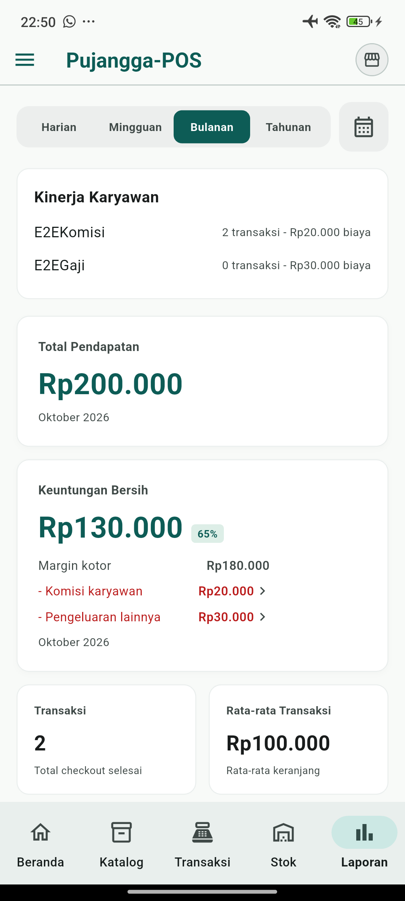

# Karyawan, pengeluaran, dan margin jasa

## Perilaku

- Atur karyawan melalui Pengaturan, dengan skema komisi atau gaji bulanan.
- Komisi dapat berlaku untuk barang, jasa, atau keduanya. Dasarnya adalah penjualan setelah diskon dan sebelum pajak; diskon transaksi dibagi proporsional.
- Pilih karyawan saat menyelesaikan transaksi. Nama, skema, cakupan, dan nilai komisi disimpan sebagai snapshot riwayat. Komisi tercatat sebagai pengeluaran secara atomik bersama penjualan; pembatalan transaksi menghapus pengeluaran komisinya.
- Sebelum pembacaan keuangan melalui repository (termasuk modal/sisa kas, dashboard, laporan karyawan, dan daftar pengeluaran), seluruh kewajiban gaji dari periode efektif pertama sampai waktu acuan aplikasi direkonsiliasi dalam satu transaksi. Rentang laporan hanya menyaring hasil baca; membuka laporan lama atau masa depan tidak menentukan periode pencatatan gaji. Datasource laporan hanya membaca data. Status aktif, skema, dan nominal menggunakan riwayat kompensasi per periode; perubahan master tidak menulis ulang periode sebelumnya. Rekonsiliasi berulang dan pembacaan bersamaan tidak menggandakan gaji karena indeks unik karyawan dan bulan.
- Gaji penuh tanpa prorata menjadi kewajiban pada awal bulan atau awal periode aktif bergaji pertama dalam bulan itu. Perubahan gaji di tengah bulan memengaruhi kewajiban bulan berikutnya; penonaktifan tidak menghapus kewajiban yang sudah timbul. Tanggal dan nominal pengeluaran otomatis maupun manual mengikuti aturan yang sama.
- Pada form pengeluaran kategori Gaji Karyawan, pilihan karyawan mengisi nominal otomatis dari data gajinya. Pengeluaran gaji kedua pada bulan yang sama ditolak.
- Margin kotor = penjualan setelah diskon sebelum pajak − biaya barang − biaya langsung jasa. Laba bersih = margin kotor − seluruh pengeluaran, termasuk komisi dan gaji, masing-masing satu kali.
- Jasa tanpa biaya langsung harus dipilih secara eksplisit sebagai biaya Rp0. Biaya kosong berarti belum diketahui. Transaksi historis tanpa snapshot biaya tetap berstatus margin belum lengkap; mengubah katalog tidak menulis ulang riwayat.

## Penyimpanan dan versi

Schema SQLite naik dari 12 ke 15 melalui migrasi tambahan tabel/kolom dan indeks, termasuk `employee_compensation_periods`. Backup menyertakan karyawan dan riwayat kompensasi; restore menerima schema 12–15 dengan default untuk kolom baru. Pada migrasi/restore schema lama, riwayat awal menggunakan nilai master yang masih tersedia; perubahan yang sudah tertimpa sebelum schema 15 tidak dapat direkonstruksi. Pengeluaran yang sudah tercatat tetap dipertahankan. Versi aplikasi tetap `1.2.2+3`, dan Pengaturan serta dialog Tentang menampilkan `v1.2.2+3`.

Pilihan karyawan di keranjang dibuat ulang ketika ID pilihan berubah atau transaksi direset. ID yang sudah tidak ada dalam daftar aktif dinormalkan menjadi tanpa karyawan dan dibersihkan dari state transaksi.

Navigasi utama tetap lima tab. Halaman karyawan dan pengeluaran menjadi subflow. Tambahan yang memperluas referensi Stitch adalah ringkasan karyawan di laporan, rincian komisi pada laba/riwayat, dan pilihan karyawan di keranjang/form gaji, sesuai kebutuhan fitur ini.

## Bukti pengujian sebelum PR

Pada 22 Oktober 2026, E2E dilakukan di Android menggunakan paket aplikasi terpisah dengan database baru. Semua input melalui UI; pemeriksaan SQLite memakai salinan database sintetis tersebut. Data usaha pengguna tidak dipakai untuk transaksi pengujian. Paket E2E telah dihapus setelah selesai.

| Skenario | Hasil |
| --- | --- |
| Dua jasa, masing-masing Rp100.000; biaya Rp0 dan Rp20.000 | Pendapatan Rp200.000; margin kotor Rp180.000 |
| Komisi jasa 10% dan gaji Rp30.000 | Komisi Rp20.000; laba bersih Rp130.000 (65%) |
| Laporan harian, bulanan, dan buka ulang aplikasi | Nilai konsisten; gaji tidak ganda |
| Riwayat transaksi | Karyawan dan komisi Rp10.000 per transaksi tampil |
| Form gaji | Nominal otomatis; duplikasi ditolak |
| Penjualan jasa | Tidak ada pergerakan stok |
| Pembukaan pertama keranjang | Pilihan karyawan muncul setelah provider selesai dimuat |

E2E di atas dan 34 test regresi dilakukan sebelum perubahan lanjutan pada commit `99435cd`. Commit tersebut menambahkan schema 15, `employee_compensation_periods`, dan normalisasi/reset pilihan karyawan. Hasil E2E tersebut bukan verifikasi perilaku setelah perubahan ini; E2E belum diulang pada commit tersebut.

Pada commit `99435cd`, [CI Analyze and test](https://github.com/iqbalmaulana03/pujangga-pos/actions/runs/39978478600) berhasil menjalankan analisis Dart dan suite test Flutter. `test/commission_scope_test.dart` mencakup migrasi dari schema 13 ke 15 sambil mempertahankan snapshot transaksi. `test/employee_cost_ui_test.dart` mencakup pengisian nominal gaji melalui provider yang dioverride; test tersebut tidak membuktikan normalisasi/reset pilihan karyawan. `test/transaction_employee_loading_test.dart` mencakup pemuatan pilihan karyawan pada pembukaan pertama keranjang, bukan reset setelah submit atau penghapusan ID karyawan nonaktif. Suite pada commit tersebut belum secara khusus menguji seluruh siklus perubahan gaji, skema, dan status aktif lintas bulan. Test SQLite menggunakan database sementara; test widget terkait menggunakan provider yang dioverride. Keberhasilan CI ini tidak memperluas cakupan skenario yang diuji.

## Pengujian ulang setelah review

Regresi #53: `test/salary_financial_reads_test.dart` memakai SQLite dalam direktori sementara dan clock terkontrol. Sepuluh tes memeriksa urutan modal/laporan tahunan/dashboard/laporan karyawan/daftar pengeluaran, rekonsiliasi berulang dan bersamaan, batas kewajiban masa depan, riwayat perubahan gaji dan penonaktifan, rollback seluruh transaksi, serta datasource yang hanya membaca. Tes widget memakai form stok asli untuk membuktikan pembelian stok yang melebihi sisa kas tetap ditolak sebelum dan sesudah laporan lama dibuka. Verifikasi lokal pada 11 November 2026 dengan Flutter 3.47.9: 210 tes lulus dan `flutter analyze --no-pub` tanpa temuan. Ini pengujian host dan widget; bukan E2E perangkat Android untuk #53.

Pada 23 Oktober 2026, pengujian ulang Android dan suite yang diperluas selesai: 70 test lulus, termasuk siklus kompensasi lintas bulan serta reset pilihan karyawan. Satu bug tambahan pada request ID karyawan hilang/nonaktif diperbaiki dan diuji rollback-nya. Lihat [hasil lengkap, batas cakupan, dan screenshot](verification/PR40-REVIEW-E2E.md).
