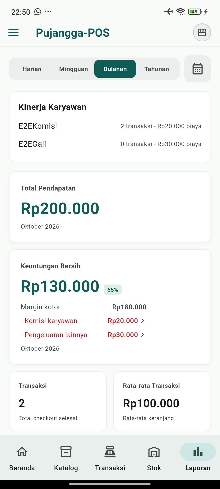

# Karyawan, pengeluaran, dan margin jasa

## Perilaku

- Atur karyawan melalui Pengaturan, dengan skema komisi atau gaji bulanan.
- Komisi dapat berlaku untuk barang, jasa, atau keduanya. Dasarnya adalah penjualan setelah diskon dan sebelum pajak; diskon transaksi dibagi proporsional.
- Pilih karyawan saat menyelesaikan transaksi. Nama, skema, cakupan, dan nilai komisi disimpan sebagai snapshot riwayat. Komisi tercatat sebagai pengeluaran secara atomik bersama penjualan; pembatalan transaksi menghapus pengeluaran komisinya.
- Gaji bulanan dicatat ketika tampilan keuangan dibuka, mengikuti tanggal efektif karyawan dan periode yang diminta. Indeks unik mencegah gaji ganda untuk karyawan dan bulan yang sama.
- Pada form pengeluaran kategori Gaji Karyawan, pilihan karyawan mengisi nominal otomatis dari data gajinya. Pengeluaran gaji kedua pada bulan yang sama ditolak.
- Margin kotor = penjualan setelah diskon sebelum pajak − biaya barang − biaya langsung jasa. Laba bersih = margin kotor − seluruh pengeluaran, termasuk komisi dan gaji, masing-masing satu kali.
- Jasa tanpa biaya langsung harus dipilih secara eksplisit sebagai biaya Rp0. Biaya kosong berarti belum diketahui. Transaksi historis tanpa snapshot biaya tetap berstatus margin belum lengkap; mengubah katalog tidak menulis ulang riwayat.

## Penyimpanan dan versi

Schema SQLite naik dari 12 ke 14 melalui migrasi tambahan tabel/kolom dan indeks. Backup menyertakan karyawan; restore menerima schema 12–14 dengan default untuk kolom baru. Versi aplikasi tetap `1.2.2+3`, dan Pengaturan serta dialog Tentang menampilkan `v1.2.2+3`.

Navigasi utama tetap lima tab. Halaman karyawan dan pengeluaran menjadi subflow. Tambahan yang memperluas referensi Stitch adalah ringkasan karyawan di laporan, rincian komisi pada laba/riwayat, dan pilihan karyawan di keranjang/form gaji, sesuai kebutuhan fitur ini.

## Bukti pengujian sebelum PR

Pada 22 Oktober 2026, E2E dilakukan di Android menggunakan paket aplikasi terpisah dengan database baru. Semua input melalui UI; pemeriksaan SQLite memakai salinan database sintetis tersebut. Data usaha pengguna tidak dipakai untuk transaksi pengujian. Paket E2E telah dihapus setelah selesai.

| Skenario | Hasil |
| --- | --- |
| Dua jasa, masing-masing Rp100.000; biaya Rp0 dan Rp20.000 | Pendapatan Rp200.000; margin kotor Rp180.000 |
| Komisi jasa 10% dan gaji Rp30.000 | Komisi Rp20.000; laba bersih Rp130.000 (65%) |
| Laporan harian, bulanan, dan buka ulang aplikasi | Nilai konsisten; gaji tidak ganda |
| Riwayat transaksi | Karyawan dan komisi Rp10.000 per transaksi tampil |
| Form gaji | Nominal otomatis; duplikasi ditolak |
| Penjualan jasa | Tidak ada pergerakan stok |
| Pembukaan pertama keranjang | Pilihan karyawan muncul setelah provider selesai dimuat |

34 test regresi lulus sebelum pemindahan branch. Basis `main` terbaru hanya berbeda pada workflow CI dari basis pengujian; kode fitur dipindahkan tanpa perubahan selain label versi lengkap. Test menggunakan SQLite sementara atau provider widget yang dioverride. Bukti ini tidak menyatakan pengujian telah diulang pada commit PR.

