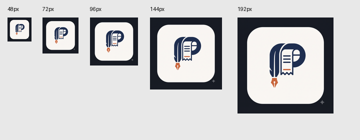
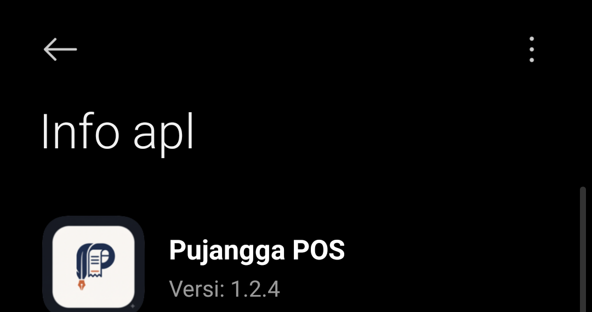
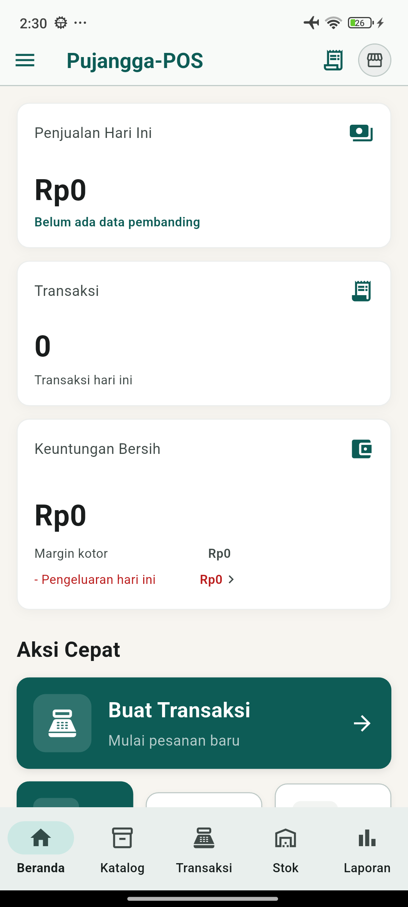

# Verifikasi optimasi ukuran Android

Tanggal: 31 Oktober 2026 (WIB). Mode implementasi lokal; tidak ada publikasi Play.

## Target dan sumber

- Checkout awal tetap pada `release/1.2.3+4_apps`, commit
  `0e7cb8fde582f64d2ec4b7b018d8dbe42b37809c`.
- Branch kerja `perf/reduce-android-download`, worktree
  `build/size-optimization`, dibuat dari `origin/main` terbaru:
  `df08f4bf7aa22ea0cc68ca44266f6f5a09f8c765` (aplikasi `1.2.4+5`).
- Baseline dan optimasi memakai Flutter **3.47.9**, revision
  `c197ca5199e9ee5661e865596c9c07294dfab51c`, Dart **3.13.7**,
  Java Temurin **17.0.19**, lockfile identik, signing lokal identik,
  dan perintah `flutter build appbundle --release --no-pub`.
- Bundletool **1.18.3**, SHA-256
  `a099cfa1543f55593bc2ed16a70a7c67fe54b1747bb7301f37fdfd6d91028e29`.
- Profil diperoleh melalui ADB dari Redmi `2201116TG`: Android API 33,
  ABI utama ARM64, density 440, locale `in-ID`. Profil lengkap disimpan bersama
  artefak pengukuran, tanpa nomor seri perangkat atau isi data usaha.

## Hasil sebelum/sesudah

Angka berikut adalah **byte desimal**, bukan MiB. Estimasi download dihitung
dengan `bundletool get-size total` untuk profil identik; bukan transfer Play
Store yang diukur langsung.

| Metrik | Baseline | Optimasi | Pengurangan |
| --- | ---: | ---: | ---: |
| AAB unggahan | 83.693.372 | 67.426.511 | 16.266.861 |
| Total APK terpilih untuk perangkat | 45.763.957 | 29.498.741 | 16.265.216 |
| Estimasi download minimum | 29.469.367 | 13.201.845 | 16.267.522 (55,20%) |
| Estimasi download maksimum | 29.469.367 | 13.201.845 | 16.267.522 (55,20%) |
| Lima PNG ikon di dalam AAB, sebelum kompresi ZIP | 16.321.915 | 59.854 | 16.262.061 |

Minimum dan maksimum identik untuk profil ini. Target <35.000.000 byte dinilai
dengan nilai **maksimum** optimasi, 13.201.845 byte, sehingga tercapai pada build
pengukuran ini. AAB final setelah optimasi RAM/perbaikan logo belum diukur ulang.
Lima PNG di source berjumlah
65.318 byte, di bawah batas CI 250.000 byte; AAPT menghasilkan ukuran paket yang
sedikit berbeda. Dimensi sekarang mdpi 48, hdpi 72, xhdpi 96, xxhdpi 144,
xxxhdpi 192 piksel. Artwork, proporsi, dan warna dipertahankan tanpa crop atau
kuantisasi warna. Master 2048 x 2048 disimpan di `tools/artwork/` dan terbukti
tidak ikut dalam AAB.

Pemeriksaan SHA-256 terhadap **30 entri library native, DEX, dan aset runtime**
menunjukkan semuanya identik pada kedua AAB, termasuk scanner native serta
model ML Kit. Kesimpulan hash hanya berlaku pada 30 entri yang diperiksa;
ini bukan pembuktian bahwa seluruh source, dependensi, atau perilaku identik.
Kedua build pengukuran berasal dari `df08f4b` dengan hash lockfile identik,
bukan perbandingan checkout rilis `0e7cb8f` terhadap `df08f4b`. Kedua revision
tersebut memang memiliki perbedaan versi aplikasi dan metadata dependensi,
tetapi artefak rilis historis dibahas terpisah di bawah dan bukan baseline.

## Artefak dan keterulangan

Artefak lokal berada di `build/size-audit/` dalam worktree dan diabaikan Git:

| Artefak | SHA-256 |
| --- | --- |
| `baseline.aab` | `dfbbd7090de4f37e52a895273674185cc440439dafb658b39c9c630d427c6224` |
| `optimized.aab` | `c19955f91e96f664375214e3d70e5734fb34fd24b26fd0addffa13050168e5fc` |

`before.json` dan `after.json` mencatat source/status checkout, hash lockfile,
metadata SDK, checksum artefak, APK terpilih, profil, dan estimasi download.
Ringkasan metadata asli kedua laporan tersedia di
[ANDROID-SIZE-MEASUREMENTS.json](ANDROID-SIZE-MEASUREMENTS.json), termasuk
revision, status checkout, hash lockfile, checksum AAB, dan nilai min/max.
File `.apks` berisi hasil bundletool yang ditandatangani dengan key debug untuk
pengukuran; bukan paket untuk dipasang di atas aplikasi Play.

Artefak CI historis juga berhasil diambil dari GitHub Actions run
`40065800460`, revision `0e7cb8f`, nama `pujangga-pos-1.2.3+4`.
AAB lama berukuran 83.063.218 byte, SHA-256
`ab088c23c98028b06fe492c454cbd45edafa70a0145cecdc9b10d15aad5f47e3`.
Untuk profil dan bundletool yang sama, estimasinya 29.383.249 byte dan APK
terpilih 45.518.197 byte. Angka historis ini **tidak** dipakai sebagai baseline
optimasi karena SDK dan source berbeda dari `main` terbaru.

## Pemeriksaan

- `flutter analyze --fatal-infos --no-pub`: lulus tanpa temuan.
- Pada tahap awal audit ukuran, `flutter test --no-pub --reporter expanded`
  menjalankan seluruh suite saat itu: **70 tes lulus**, bukan subset suite akhir.
  Pada head PR `f649818`, pemeriksaan seluruh suite diulang setelah penambahan
  tes RAM/logo: **93 tes lulus**. Suite SQLite menggunakan factory FFI dan
  direktori sementara khusus; tes UI memakai mock/provider uji.
  Database HP tidak digunakan.
- Revisi review menambahkan tiga regresi lifecycle scanner (`null`, resumed,
  paused): seluruh **96 tes lulus**, analisis Flutter bersih, dan kedua YAML
  workflow valid. Root arsip AAB serta pin SHA action diverifikasi lokal;
  job publikasi tidak dijalankan untuk pengujian ini.
- Build AAB release baseline dan optimasi: lulus.
- Regenerasi ikon dua kali: SHA-256 seluruh PNG identik.
- Guard CI: menerima PNG baru; menolak ikon lama, dimensi salah, budget
  berlebihan, header tidak valid, dan file hilang menggunakan fixture sementara.
- Preview visual ukuran 48/72/96/144/192 piksel diperiksa; artwork tetap sama.
- Kedua workflow YAML dapat diparse; workflow pengukuran hanya manual dan tidak
  mengandung langkah publikasi/credential Play. Eksekusi workflow GitHub belum
  dilakukan pada branch lokal ini.
- `jarsigner -verify optimized.aab`: `jar verified`, exit code 0. Tool juga
  memberi peringatan sertifikat upload self-signed/tanpa timestamp dan urutan
  entri ZIP/JarInputStream; validasi AAB dan pembuatan APK oleh bundletool lulus.

## Uji perangkat terisolasi

Paket QA baru `com.pujanggapos.pujangga_pos.sizeaudit` diverifikasi belum ada
sebelum pemasangan. Android memberinya UID terpisah `10361` dan direktori data
`/data/user/0/com.pujanggapos.pujangga_pos.sizeaudit`. Tidak ada pembacaan atau
pengujian transaksi pada database aplikasi Play. Dialog instalasi USB sempat
ditolak oleh HP; pemasangan ulang berhasil setelah pengguna menyiapkan dan
menyetujui pemasangan.

Build QA memakai entrypoint sementara di `build/size-audit/`, application ID
terpisah, dan penghapusan eksplisit permission `INTERNET` dari manifest QA.
Entrypoint memanggil startup aplikasi asli dan menguji decoder melalui
`MobileScannerController.analyzeImage` dengan gambar EAN-13 sintetis
`5901234123457`. Ini bukan perubahan pada APK/AAB produksi yang diukur.
Konfigurasi Gradle dan manifest produksi dipulihkan byte demi byte setelah
kompilasi QA; seluruh salinan keystore/properties sementara dihapus.

| Skenario | Hasil teramati |
| --- | --- |
| Instalasi baru dan startup | Halaman setup tampil pada database QA kosong |
| Setup sintetis `SizeAuditQA`, kategori Kedai Kopi | Berhasil masuk Beranda; nilai penjualan/transaksi nol |
| Lima tab utama | Selected state Katalog, Transaksi, Stok, Laporan, Beranda diverifikasi melalui UI Automator |
| Decoder barcode tanpa izin internet | Log `SIZE_AUDIT_OFFLINE_BARCODE_PASS`; fixture EAN-13 terbaca |
| Halaman pemindai | Kamera perangkat 0 tersambung ke paket QA; tombol kembali membuka Transaksi |
| Ikon pada Android | Artwork diperiksa pada Info aplikasi Android pada density 440; preview mdpi sampai xxxhdpi diperiksa terpisah |
| Log proses QA | Tidak ada marker `FATAL EXCEPTION`, `Unhandled Exception`, atau `SQLiteException` pada sampel maksimal 1.500 baris |
| Pembersihan | Paket QA dan XML UI sementara dihapus; pemasangan Play tetap `1.2.3+4`, installer `com.android.vending` |

Tes decoder memakai gambar fixture, bukan barcode fisik yang diarahkan ke
kamera. Ini membuktikan model yang dibundel dapat mendekode offline; kamera
diverifikasi terpisah dapat dibuka dan ditutup. Tidak ada pengujian fisik pada
perangkat mdpi kedua, stress test, atau benchmark RAM pada tahap ini.

Build awal terhenti pada signing karena lokasi keystore di worktree belum
lengkap. Lokasi salinan sementara diperbaiki dan build ulang lulus. Build juga
mengeluarkan peringatan KGP dari `file_picker` dan `share_plus`, serta parser
metadata Android SDK; ini tidak menyebabkan kegagalan build final.

## Batas bukti

Ukuran AAB dan APK terpilih bukan ukuran transfer unduhan yang sebenarnya.
Angka 44,69 MB dari pengguna belum diverifikasi melalui Play Console. Laporan
ini membuktikan pengurangan paket dan estimasi transfer pada konfigurasi yang
sama; verifikasi angka unduhan Play dilakukan pada rilis berikutnya yang
diotorisasi terpisah. Tidak ada upload Play, rollout, atau perubahan versi.

Petunjuk pengukuran ulang dan workflow tersedia di [ANDROID-SIZE.md](../ANDROID-SIZE.md).
