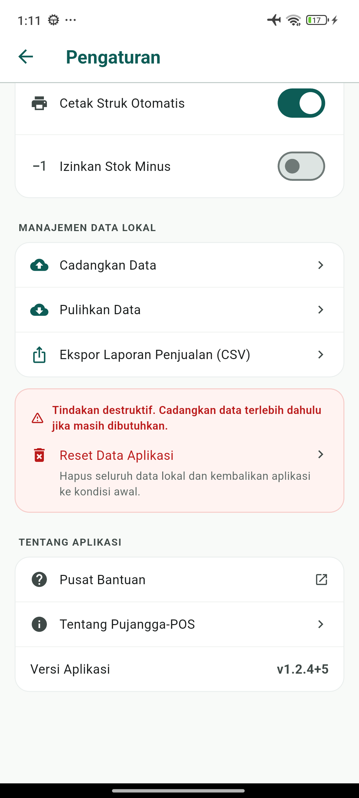
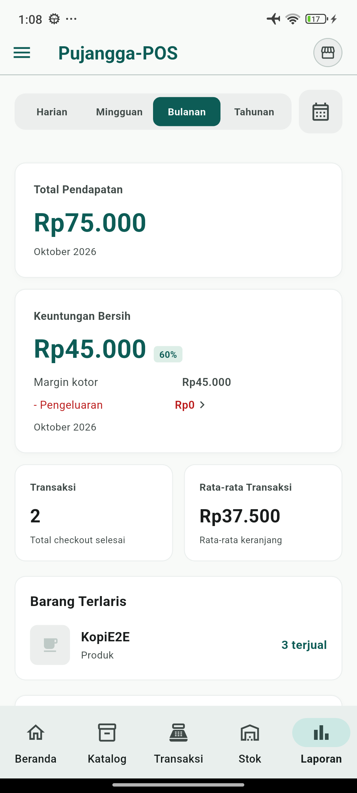
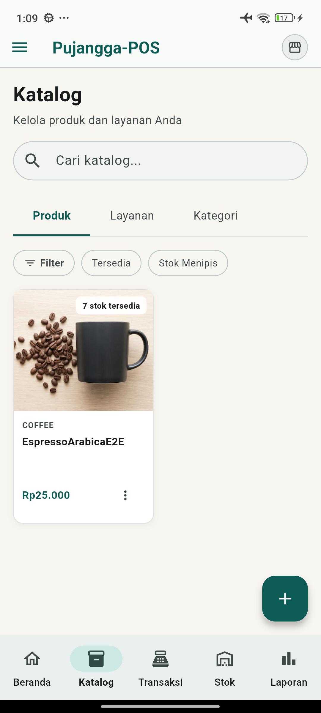

# Verifikasi pembaruan keamanan Flutter/Dart

Tanggal: 30–31 Oktober 2026 (WIB). Pengujian perangkat dan pembaruan versi dilakukan pada 31 Oktober.

## Sumber dan SDK

- Branch kerja: `fix/flutter-security-update`, dibuat dari `origin/main` pada `bfe413f13fc2067ffd4d2e8297f869655edfe8bd`.
- Versi aplikasi dinaikkan dari sumber `main` (`1.2.2+3`) menjadi **`1.2.4+5`**, setelah memeriksa branch rilis terakhir dan aplikasi utama di ponsel (`1.2.3+4`). Pengaturan serta dialog Tentang menampilkan `v1.2.4+5`.
- Flutter stable `3.47.9`, revision `c197ca5199e9ee5661e865596c9c07294dfab51c`.
- Dart bawaan `3.13.7`; engine `89c39edfdfae2949f6806e4a315c0c08522238b7`.
- Verifikasi menggunakan environment Puro terpisah `security-patch`; environment SDK default tetap Flutter `3.44.1`.
- Tag SDK diverifikasi terhadap repository resmi Flutter. [Advisori GHSA-frr6-h895-5pxp](https://github.com/dart-lang/sdk/security/advisories/GHSA-frr6-h895-5pxp) menetapkan perbaikan minimum Flutter `3.47.8` dan Dart `3.13.7`.

## Perubahan dependency dan konfigurasi

Kedua job CI menggunakan Flutter `3.47.9`. Constraint proyek menetapkan Dart `^3.13.7` dan Flutter `>=3.47.8`.

Percobaan awal `flutter pub get --enforce-lockfile` menolak lockfile lama. Resolusi dengan SDK baru hanya mengubah enam dependency transitif: `matcher` `0.12.19` → `0.12.20`, `meta` `1.18.0` → `1.19.0`, `test` `1.31.0` → `1.31.1`, `test_api` `0.7.11` → `0.7.12`, `test_core` `0.6.17` → `0.6.18`, serta `vector_math` `2.2.0` → `2.4.4`. Versi package lainnya tetap.

Migrasi bawaan Flutter menambahkan pengecualian `build/**` dan `android/**` ke konfigurasi analyzer. Perubahan kode produk hanya menaikkan konstanta versi; skema SQLite dan layout UI tetap.

## Pemeriksaan

Perintah dijalankan dengan executable Flutter dari environment `security-patch`, melalui proxy RTK.

| Pemeriksaan | Hasil |
| --- | --- |
| `flutter --version --machine` | Flutter dan Dart sesuai revision di atas |
| `flutter pub get --enforce-lockfile` setelah pembaruan lockfile | Lulus |
| `flutter analyze --fatal-infos --no-pub` | Lulus, tanpa temuan |
| `flutter test --no-pub --reporter expanded` | 70 tes lulus |
| `flutter build apk --debug --no-pub` | Lulus; versi terpasang `1.2.4-debug`, versionCode `5`, minSdk `24`, targetSdk `36` diverifikasi melalui Package Manager Android |
| `flutter build appbundle --release --no-pub` | Lulus; AAB bertanda tangan, runtime ARMv7, ARM64, dan x86_64 tersedia |
| `jarsigner -verify` pada AAB | Lulus, `jar verified.` dan exit code `0` |
| `git diff --check` | Lulus |

Sebelum tes, akses SQLite diperiksa: kelima suite yang membuka database menggunakan `databaseFactoryFfi`, `Directory.systemTemp.createTemp`, dan `setDatabasesPath` ke direktori sementara; teardown menghapus database sementara. Tes widget mengganti provider atau repository dengan implementasi pengujian. Tes ekspor CSV membangun teks tanpa membuka database. Tidak ada database perangkat atau layanan produksi yang digunakan.

## Artefak lokal

Artefak dan manifest bukti disimpan pada direktori `build/` di worktree, yang diabaikan Git. Manifest `build/security-update/manifest.json` mencatat revision sumber dan SDK, hasil pemeriksaan, ukuran, serta SHA-256 artefak.

| Artefak | Ukuran byte | SHA-256 |
| --- | --- | --- |
| `build/app/outputs/flutter-apk/app-debug.apk` (`1.2.4+5`) | 210735673 | `f2a0e7730ea5e61463bc6c7b2504cafcada62b3454a745e886c3db6126931c2d` |
| `build/app/outputs/bundle/release/app-release.aab` (`1.2.4+5`) | 83693526 | `ba80da1cd859e6056e90983dc35c43c004f400cae96e967cef0ce212796c9d89` |

## E2E pada ponsel Android

Target: Xiaomi/Redmi `2201116TG`, Android 13, melalui ADB. Sebelum pemasangan, Package Manager dan `run-as` memastikan paket debug belum ada. Seluruh data dibuat melalui UI pada paket baru `com.pujanggapos.pujangga_pos.debug`, dengan direktori data terpisah dari aplikasi utama. Tidak ada pengujian atau pembacaan database aplikasi utama `com.pujanggapos.pujangga_pos`; versi terpasangnya tetap `1.2.3` build `4` saat pemeriksaan akhir.

Baseline menggunakan APK debug `1.2.2` build `3` yang dibuat sebelumnya dengan SDK yang ditambal. Setelah data sintetis disimpan, `adb install -r` memperbaruinya ke `1.2.4` build `5`. Ini menguji pembaruan paket debug dan persistensi data, bukan jalur distribusi Play Store atau migrasi schema.

| Skenario | Hasil teramati |
| --- | --- |
| Setup bisnis pada database kosong | Profil sintetis tersimpan, beranda kosong tampil |
| Penambahan stok tanpa kas | Ditolak dengan pesan sisa kas tidak mencukupi |
| Modal Rp1.000.000; barang harga jual Rp25.000 dan modal Rp10.000; tambah stok 10 | Nilai dan histori stok tersimpan |
| Transaksi tunai 2 unit sebelum upgrade | Total Rp50.000; stok 8; struk berhasil |
| Upgrade APK tanpa menghapus data | Seluruh baris di seluruh tabel SQLite identik sebelum/sesudah upgrade |
| Versi pada Android, Pengaturan, dan dialog Tentang | `1.2.4-debug`, build `5`; UI `v1.2.4+5` |
| Transaksi 1 unit setelah upgrade, metode QRIS sebagai label pembayaran lokal | Rp25.000 tersimpan; stok 7; struk berhasil |
| Riwayat serta laporan harian/bulanan | 2 transaksi; omzet Rp75.000; HPP Rp30.000; margin/laba Rp45.000; 60% |
| Edit nama master untuk memicu gambar HTTPS bawaan | Gambar katalog tampil; snapshot nama pada transaksi lama tetap `KopiE2E` |
| Hentikan aplikasi lalu buka ulang | Beranda tetap 2 transaksi, Rp75.000, laba Rp45.000; seluruh baris database identik sebelum/sesudah restart |
| Rekonsiliasi SQLite | Schema 15; 1 barang; 2 penjualan/detail; 3 pergerakan stok; `integrity_check=ok`; `foreign_key_check` kosong |

Snapshot hanya diambil dari database debug setelah proses paket uji dihentikan, termasuk file jurnal jika ada. Hash logis seluruh tabel sebelum/sesudah upgrade sama: `e2e96c2e6a962930a01aa24abe46044daf6574315882bf0235fb887f8055ef59`. Setelah transaksi tambahan dan perubahan nama master, hash sebelum/sesudah restart sama: `cb76ec8130b31ba72370bf63101285d0424eac93cbe1571963675feb3c57f965`.

Pemeriksaan log yang dibatasi pada PID aplikasi uji tidak menemukan `FATAL EXCEPTION`, `Unhandled Exception`, `SQLiteException`, atau `HandshakeException` dalam sampel 2.000 baris terakhir sebelum restart. Ini bukan jaminan bebas bug pada seluruh fitur. Paket debug dengan data sintetis ditinggalkan di ponsel untuk inspeksi; aplikasi utama tidak diganti.

## Batas bukti dan rilis

Build menampilkan peringatan bahwa `file_picker` dan `share_plus` masih menggunakan Kotlin Gradle Plugin yang perlu dimigrasikan untuk versi Flutter mendatang. Versi plugin dipertahankan karena build SDK yang ditargetkan tetap didukung. Ada pula peringatan ketidaksamaan versi parser metadata Android SDK; build APK tetap berhasil.

Verifikasi perangkat mencakup skenario pada tabel E2E, pada satu ponsel Android 13 dengan APK debug. Build release bertanda tangan diperiksa terpisah; pemasangan melalui Play Store belum diuji.

Tes fungsional tidak menguji eksploit TLS. Bukti perbaikan keamanan adalah penggunaan SDK resmi yang ditambal dan build ulang dengan SDK tersebut. APK yang sudah terpasang belum menerima perbaikan sampai pengguna memperbarui aplikasinya.

Publikasi Google Play, perubahan rollout, dan push ke `main` atau `release/*` berada di luar pekerjaan ini. VersionCode `5` lebih tinggi daripada branch rilis terakhir dan aplikasi utama yang diperiksa, tetapi tetap perlu diverifikasi terhadap seluruh versi di Play Console sebelum publikasi. Salinan material signing sementara di worktree dihapus setelah build dan verifikasi; material asli di checkout awal tetap dipertahankan. Nilainya tidak dicetak atau dimasukkan ke commit. CI dan CodeRabbit pada commit awal PR (`92a9b31`) berhasil; status commit lanjutan perlu diverifikasi setelah push.
