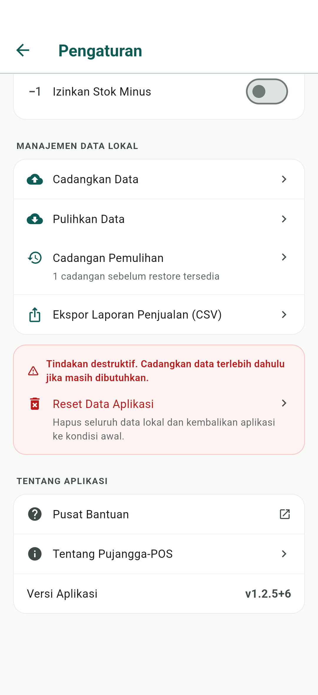
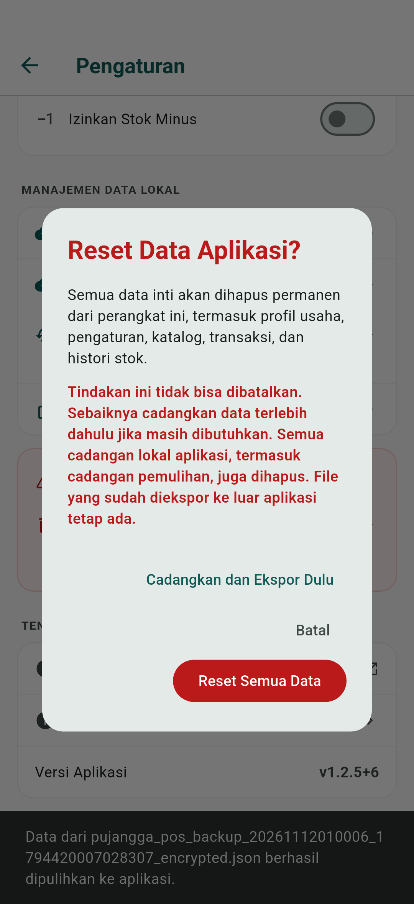

# Cadangan pemulihan sebelum restore — issue #56

Verifikasi 12 November 2026 dengan Flutter 3.47.9 / Dart 3.13.7, basis
`bbbe29a380adc357eefa32a212bc6fb108ba47bc` dari `origin/main`.

## Perilaku

- Konfirmasi restore meminta kata sandi baru untuk snapshot data aktif. Snapshot
  wajib memakai envelope enkripsi backup utama; kata sandi tidak dipersistenkan.
- Snapshot membaca semua tabel dalam satu transaksi SQLite dan menyertakan logo.
  File terenkripsi ditulis ke staging privat, dibaca kembali melalui validator
  restore, lalu dipublikasikan dengan rename sebelum penggantian data dimulai.
  Kegagalan penulisan, validasi, atau logo yang tidak lengkap membatalkan restore.
- Pengaturan → Manajemen Data Lokal → Cadangan Pemulihan menyediakan daftar
  waktu cadangan. File tetap ditemukan setelah restart; pembukaan membutuhkan
  kata sandi yang dibuat sebelum restore. Pemulihan snapshot juga mencadangkan
  dataset aktif terlebih dahulu. Cadangan yang sudah valid tidak otomatis dibuang.
- Selama restore/reset, interaksi dan navigasi keluar Pengaturan ditahan agar
  transaksi atau perubahan profil tidak terjadi setelah snapshot diambil.
- Reset menawarkan ekspor dahulu atau langsung menghapus. Jalur ekspor memerlukan
  konfirmasi bahwa pengguna sudah menyimpan file di luar penyimpanan aplikasi;
  menu bagikan saja tidak membuktikan ekspor berhasil. Pembatalan tidak mereset.
- Reset menghapus database/logo, snapshot, ekspor backup/CSV lokal yang dikelola
  aplikasi, serta salinan cache `share_plus` dan `file_picker`. Salinan yang sudah
  disimpan di luar aplikasi tetap menjadi tanggung jawab pengguna.

## Bukti pengujian

- `flutter analyze --no-pub`: tanpa temuan.
- `flutter test --no-pub --concurrency=2 --timeout=2m`: **251 lulus**.
- Setelah penambahan pembersihan cache plugin, tes layanan pemulihan dan
  penggantian dataset diulang: **7 lulus**.
- Tes widget reset diulang setelah penambahan penguncian interaksi/navigasi:
  **1 lulus**; penguncian aktif sampai operasi selesai.
- `PUJANGGA_RECOVERY_E2E=1 flutter test --no-pub
  integration_test/recovery_backup_test.dart -d <device>`: **1 lulus**, penanda
  `ISSUE56_E2E_PASS: sale, stock, restart, recovery, reset`, terakhir 00:42 UTC
  setelah penguncian navigasi ditambahkan.
- Build memakai paket terpisah `com.pujanggapos.pujangga_pos.issue56e2e`.
  Guard tes memverifikasi nama paket serta jalur database di direktori sementara
  unik. Data seluruhnya sintetis; database aplikasi pengguna tidak dipakai.
- Android: backup dibuat pada stok 10, lalu transaksi tunai disimpan sehingga
  stok menjadi 9. Restore backup lama menghapus transaksi dan mengembalikan stok
  10. Setelah ProviderContainer dibuat ulang, snapshot ditemukan dan dipulihkan
  melalui UI: header/detail transaksi kembali, stok serta histori akhir bernilai
  9, dan `PRAGMA foreign_key_check` kosong. Reset mengembalikan layar setup dan
  menghapus snapshot serta transaksi. Ini menguji pembuatan ulang layanan dan
  pembukaan file persisten; bukan simulasi OS mematikan proses di tengah penulisan.
- Unit test juga menutup/membuka database, menolak kata sandi salah, membuktikan
  kegagalan snapshot tidak mengganti dataset aktif, dan memastikan reset menghapus
  cache lokal sambil mempertahankan salinan eksternal dan file yang tidak terkait.

Percobaan suite pertama dengan konkurensi default bersamaan dengan build Android
terkena timeout kriptografi. Hasil lulus di atas menggunakan batas waktu eksplisit;
tes pemulihan diberi timeout dua menit. Dua percobaan Android awal berhenti karena
finder tes memakai `.first` pada elemen list yang belum dibangun; finder diperbaiki
dan skenario lengkap dijalankan ulang sampai lulus.

## UI

Acuan: Pengaturan `575d0f627212423f83fa661c29db4395` dalam canonical Stitch.
Penambahan baris cadangan dan perluasan dialog reset diperlukan oleh issue #56;
urutan bagian, gaya kartu, prioritas aksi reset, dan navigasi tetap mengikuti
Pengaturan yang sudah ada. Tidak ada tab atau pola navigasi utama baru.

Screenshot Android sintetis yang diperiksa:

## Verifikasi setelah integrasi main (#55)

`main` pada `8fbeef142bb688d460974c8101f360aff08eb100` digabungkan ke branch
PR #69. Konflik hanya pada `applicationIdSuffix` di Gradle; kedua pilihan paket
`PUJANGGA_RECOVERY_E2E` (`.issue56e2e`) dan `PUJANGGA_RECEIPT_E2E`
(`.issue55e2e`) dipertahankan.

- Analyzer dengan `--fatal-infos` lulus.
- 23 tes regresi pemulihan, penggantian dataset, reset, serta berbagi struk lulus
  pada database sementara atau boundary berbagi yang diganti khusus tes.
- APK debug target `integration_test/recovery_backup_test.dart` berhasil dibangun
  dengan `PUJANGGA_RECOVERY_E2E=1`.
- E2E perangkat diulang setelah perangkat terhubung kembali pada revisi integrasi
  `7a16fe26ad7808742e1941965aa07020b4963e7c`, 12 November 2026, 01:00 UTC.
  Perintah `PUJANGGA_RECOVERY_E2E=1 flutter test --no-pub
  integration_test/recovery_backup_test.dart -d <device>` selesai **1 lulus**
  dalam 57 detik (di luar build/instalasi), dengan penanda
  `ISSUE56_E2E_PASS: sale, stock, restart, recovery, reset` dan exit code 0.
  Guard memastikan paket `.issue56e2e` dan database sementara. Restore lama,
  pemulihan transaksi/detail/stok/histori, pembatalan reset/ekspor, serta reset
  final seluruhnya lulus pada sumber yang telah digabungkan dengan main.
- Kedua screenshot di atas diperbarui dari pengulangan perangkat ini. Cakupan
  restart tetap berupa pembuatan ulang layanan, bukan force-stop proses OS.
