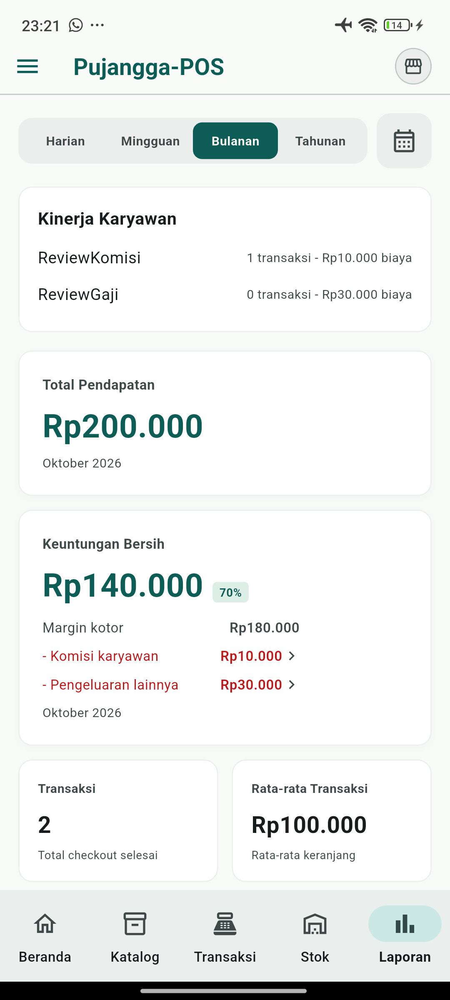
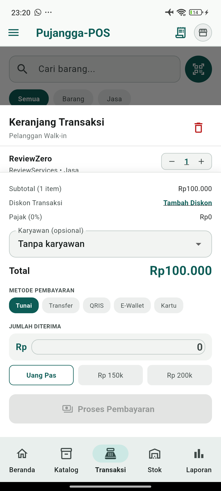
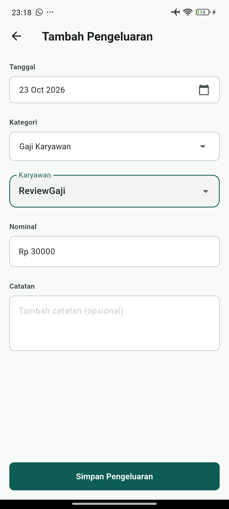

# Pengujian ulang PR #40 setelah review

## Target dan isolasi

Pengujian dilakukan pada 23 Oktober 2026 setelah commit `36bb077`, bersama patch validasi karyawan dan test regresi yang dikirim dalam commit dokumen ini. Seluruh 114 file Dart pada APK cocok dengan manifest sumber lokal yang diperiksa ulang setelah pengujian.

- Perangkat Android Xiaomi 2201116TG, paket terpisah `com.pujanggapos.pujangga_pos.reviewe2e`.
- Sebelum peluncuran pertama, direktori database paket uji belum ada. Setup bisnis, katalog, karyawan, perubahan kompensasi, dan transaksi dimasukkan melalui UI.
- Data usaha aplikasi utama tidak digunakan. Readback SQLite hanya mengambil database paket uji setelah aplikasi uji dihentikan.
- APK debug E2E SHA256: `a714a2705ce4a71b49381303af8d447491030cec42fc32e65fe7d2edfaad5c33`.
- Paket E2E telah dihapus dari HP setelah bukti disalin dan direkonsiliasi. Database dan bukti mentah sintetis disimpan lokal, tidak dimasukkan ke Git.

## Bug tambahan yang ditemukan dan diperbaiki

Jika request transaksi membawa ID karyawan yang sudah nonaktif atau tidak ditemukan, penyimpanan sebelumnya melewati perhitungan komisi dan tetap menyimpan penjualan. Dua test baru mereproduksi kegagalan ini sebelum perbaikan.

Penyimpanan kini melempar `employee_unavailable` dengan pesan untuk memilih ulang karyawan. Seluruh transaksi SQLite dibatalkan. Kedua test tersebut lulus setelah perbaikan dan memeriksa bahwa penjualan, detail, pengeluaran, stok, serta pergerakan stok tidak berubah ketika request ditolak. Skenario request basi ini diuji pada lapisan penyimpanan; pada UI Android, pilihan karyawan nonaktif dibersihkan sebelum penyimpanan.

## Hasil E2E Android

| Skenario | Hasil teramati |
| --- | --- |
| Dua jasa Rp100.000; biaya eksplisit Rp0 dan Rp20.000 | Snapshot biaya tepat; pendapatan Rp200.000; margin kotor Rp180.000 |
| Transaksi pertama memakai komisi jasa 10%; transaksi kedua tanpa karyawan | Satu komisi Rp10.000; ID karyawan transaksi kedua kosong |
| Mulai transaksi kedua setelah menyelesaikan transaksi pertama | Keranjang menampilkan Tanpa karyawan |
| Gaji Rp30.000 | Satu pengeluaran gaji; total pengeluaran Rp40.000 |
| Gaji master diubah menjadi Rp40.000 pada bulan yang sama | Form gaji menampilkan nominal periode Rp30.000 yang tidak dapat diedit |
| Percobaan mencatat gaji kedua | Ditolak dengan pesan gaji bulan ini sudah tercatat |
| Karyawan gaji dinonaktifkan | Pengeluaran Rp30.000 dan laba bulan berjalan tetap |
| Karyawan komisi dipilih di keranjang, lalu dinonaktifkan melalui Pengaturan | Keranjang kembali ke Tanpa karyawan tanpa assertion |
| Riwayat setelah karyawan dinonaktifkan | Transaksi pertama tetap menampilkan nama, cakupan jasa, dan komisi Rp10.000; transaksi kedua tidak menampilkan karyawan |
| Dashboard, laporan harian/bulanan, lalu buka ulang aplikasi | Margin kotor Rp180.000; laba bersih Rp140.000 (70%); tidak ada gaji ganda |
| Rekonsiliasi SQLite setelah restart | Schema 15; 2 penjualan; 2 pengeluaran; 5 periode kompensasi; nol pergerakan stok; integrity_check ok; foreign_key_check kosong |

Angka Rp140.000 berbeda dari E2E sebelumnya karena transaksi kedua sengaja tanpa karyawan untuk memeriksa reset pilihan. Tidak ada transaksi ketiga yang disimpan saat memeriksa penonaktifan; keranjang pengujian tersebut dikosongkan.

## Pengujian otomatis

`rtk flutter test --no-pub`: **70 test lulus** setelah seluruh perubahan kode dan test pada pekerjaan ini. Analisis statis seluruh proyek dan analisis ulang file yang berubah bersih; `git diff --check` bersih sebelum commit.

- `employee_compensation_lifecycle_test.dart`: perubahan gaji, nonaktif, aktif kembali, gaji ke komisi dan kembali ke gaji lintas Januari–September; hasil sama ketika laporan dibuka sebelum setiap perubahan maupun baru setelah semuanya berubah; laporan bulanan, pencegahan duplikasi, backup/restore, buka ulang database, serta akrual bulan berikutnya.
- File yang sama memeriksa form gaji dengan SQLite terisolasi dan provider database asli, tanpa override nominal gaji: master Rp40.000 menghasilkan nilai periode Rp30.000 pada form. Nominal manual dan tanggal akrual juga diperiksa.
- `transaction_employee_loading_test.dart`: reset setelah submit dan penghapusan pilihan nonaktif pada layout mobile dan lebar, termasuk request transaksi berikutnya tanpa ID karyawan, serta pemuatan asinkron pada pembukaan pertama keranjang.
- `commission_scope_test.dart`: dua kasus baru menolak ID karyawan hilang/nonaktif dengan rollback penuh. Test komisi, migrasi, backup, biaya jasa, dan suite lain tetap lulus.

Skenario lintas bulan memakai waktu yang diinjeksi ke repository dan layanan gaji dalam test, serta database sementara yang path-nya diperiksa. Jam HP tidak diubah. Layout lebar diperiksa melalui widget test; pengujian UI perangkat dilakukan pada HP di atas. Bukti ini terbatas pada skenario yang disebutkan dan tidak menjamin tidak adanya bug di seluruh aplikasi.
