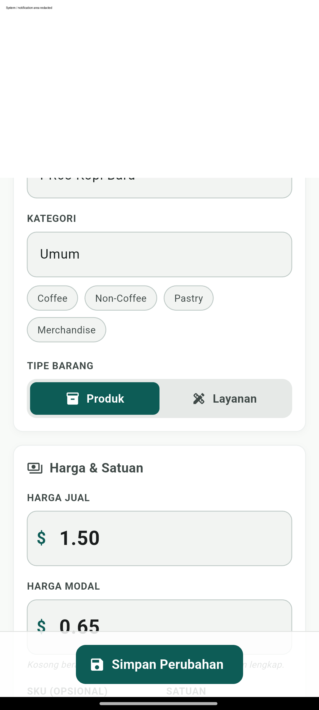
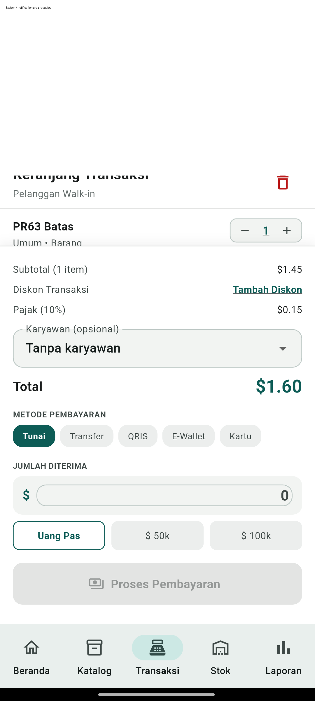
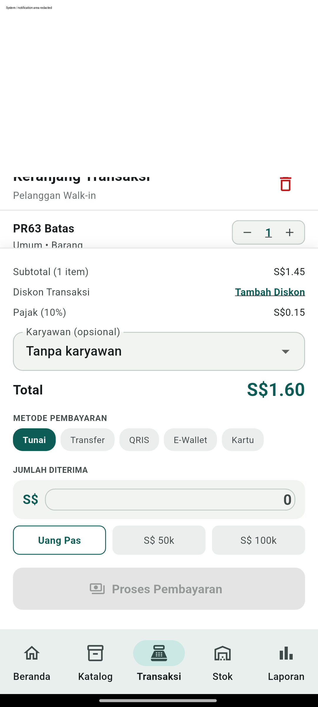
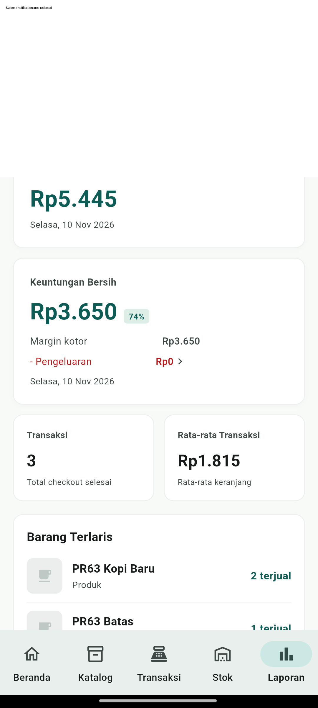
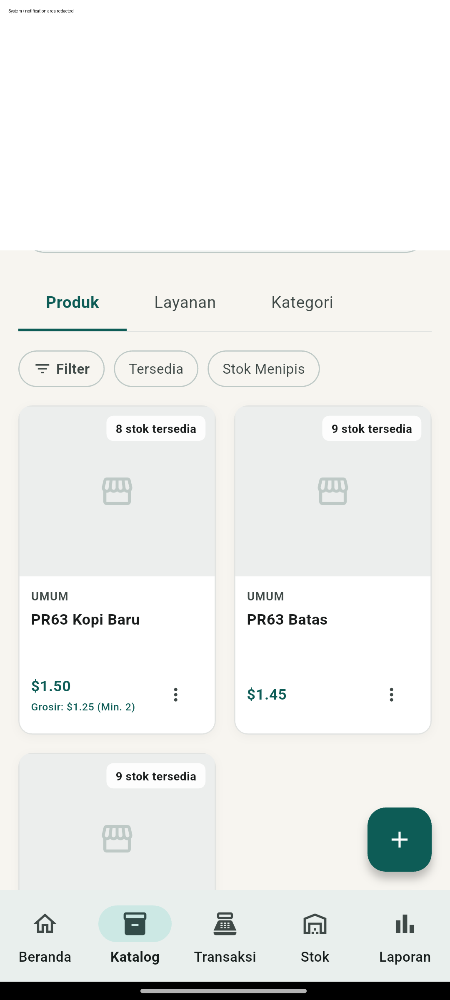

# PR #63 — verifikasi E2E presisi mata uang

Tanggal: 10 November 2026, 09:55–09:58 WIB.

**Hasil: 3 skenario Android lulus; 9 checkout tersimpan dan direkonsiliasi.**

Kode produk yang diuji: `034ca457f0cd3c3618b35fb989300e83ac861510`, head PR #63 saat pengujian. Harness ini menambahkan integration test, runner, dan suffix paket debug; tidak mengubah kode produk di `lib/`.

## Target dan isolasi

- Perangkat fisik Xiaomi 2201116TG, Android 13, ARM64.
- Flutter 3.47.9 / Dart 3.13.7; APK `1.2.5-debug`, versionCode 6.
- Paket khusus: `com.pujanggapos.pujangga_pos.pr63e2e`. Runner memverifikasi package pada manifest APK sebelum Flutter memasangnya; automatic uninstall dinonaktifkan.
- Setiap mata uang memakai database unik di cache paket uji. Test memverifikasi identitas paket dan path sebelum membuka database. Hanya `appDatabaseProvider` diganti; UI, pengaturan, repository, checkout, stok, laporan, dan SQLite Android menggunakan implementasi asli.
- Profil, katalog, dan stok awal adalah fixture sintetis. Mata uang dan pajak dipilih melalui UI. Tidak mengakses database aplikasi utama.
- Inventaris paket sebelum/sesudah tetap memuat aplikasi utama. Metadata aplikasi utama identik: versi 1.2.4, versionCode 5, waktu pembaruan 10 November 2026 09:30:39 WIB. Ini membuktikan pemasangan aplikasi utama tidak berubah; bukan pembandingan isi database produksi.
- Setelah tes, pencarian ADB pada cache paket uji tidak menemukan direktori `currency-e2e-*` yang tersisa. Paket uji dibiarkan terpasang; seluruh database sintetis dibersihkan.

## Hasil yang diverifikasi

| Skenario | USD | SGD | IDR |
| --- | --- | --- | --- |
| Edit nama melalui menu katalog dan simpan | Jual 1.50, modal 0.65, grosir 1.25 tetap tersimpan | Sama | Jual 1500, modal 650, grosir 1250 tetap tersimpan |
| Pajak default 10%, harga biasa | 1.00 + 0.10 = 1.10 | 1.00 + 0.10 = 1.10 | 1000 + 100 = 1100 |
| Batas setengah sen | 1.45 + 0.15 = 1.60 | 1.45 + 0.15 = 1.60 | 1450 + 145 = 1595 |
| Dua unit melewati minimum grosir | 2 × 1.25 + 0.25 = 2.75 | 2 × 1.25 + 0.25 = 2.75 | 2 × 1250 + 250 = 2750 |
| Laporan harian, screenshot diperiksa | 3 transaksi, pendapatan 5.45 | 3 transaksi, pendapatan 5.45 | 3 transaksi, pendapatan 5445; tanpa desimal |
| Stok item grosir setelah penjualan | 10 → 8 | 10 → 8 | 10 → 8 |
| Tutup SQLite/provider, buka kembali | 3 transaksi identik, harga jual dan pengaturan bertahan | Sama | Sama |
| `integrity_check` / `foreign_key_check` | `ok` / kosong | `ok` / kosong | `ok` / kosong |

Setiap checkout dilakukan melalui keranjang, pemilihan label pembayaran QRIS, tombol pembayaran, dan layar berhasil. Nilai subtotal, pajak, total, kuantitas, serta snapshot harga dibaca langsung dari tabel SQLite sesudah simpan. Tidak memakai mock repository atau mock penyimpanan.

## Eksekusi dan artefak

```powershell
rtk proxy C:\tmp\puro\envs\security-patch\flutter\bin\flutter.bat pub get --enforce-lockfile
rtk proxy python tools/run_currency_e2e.py --device <adb-serial> --flutter C:\tmp\puro\envs\security-patch\flutter\bin\flutter.bat
rtk proxy C:\tmp\puro\envs\security-patch\flutter\bin\flutter.bat analyze --fatal-infos --no-pub
```

- E2E: `02:51 +3: All tests passed!`; ringkasan [hasil run](pr63-currency-e2e/result.txt).
- Analyzer: tanpa temuan.
- SHA-256 APK yang diuji: `543259126fb477232f8cb3b122fb470fd4057fca84e7b1b88554f6ce1cbcf6b7`.
- Log lokal dan seluruh screenshot berada di `build/currency-e2e/` (diabaikan Git). Gambar terpilih di bawah sudah disamarkan pada 25% area atas untuk menghapus notifikasi perangkat; nilai transaksi yang menjadi bukti tetap terlihat. Jangan mempublikasikan screenshot mentah tanpa pemeriksaan dan redaksi.

Percobaan awal berhenti karena keyboard menutupi menu edit pada otomasi. Harness diperbaiki dengan menutup fokus dan memastikan menu terlihat; pengujian diulang dari database kosong sampai seluruh skenario lulus. Tidak ada perubahan kode produk untuk mengatasi kegagalan harness tersebut.

## Bukti visual











## Batas cakupan

Pengujian ini mencakup regresi issue #50 pada satu perangkat Android, menggunakan build debug dari kode produk head PR. Buka ulang berarti koneksi SQLite dan provider baru dalam proses integration test, bukan force-stop/cold-start OS. QRIS dipakai sebagai label metode pembayaran lokal, bukan pembayaran ke penyedia eksternal. Fixture awal disiapkan langsung di database; onboarding awal, seluruh fitur POS, distribusi Play Store, serta perpindahan mata uang pada transaksi historis yang sama tidak diuji di sini. Tidak dilakukan merge atau deploy.
