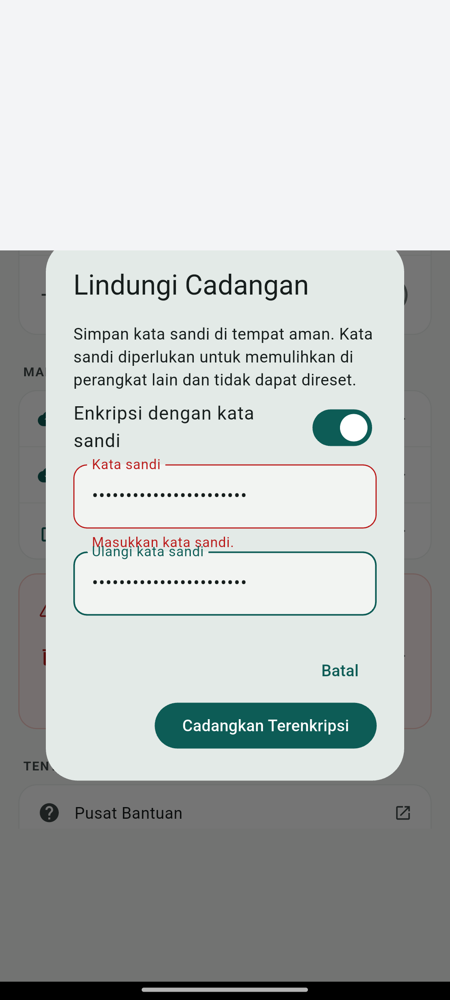
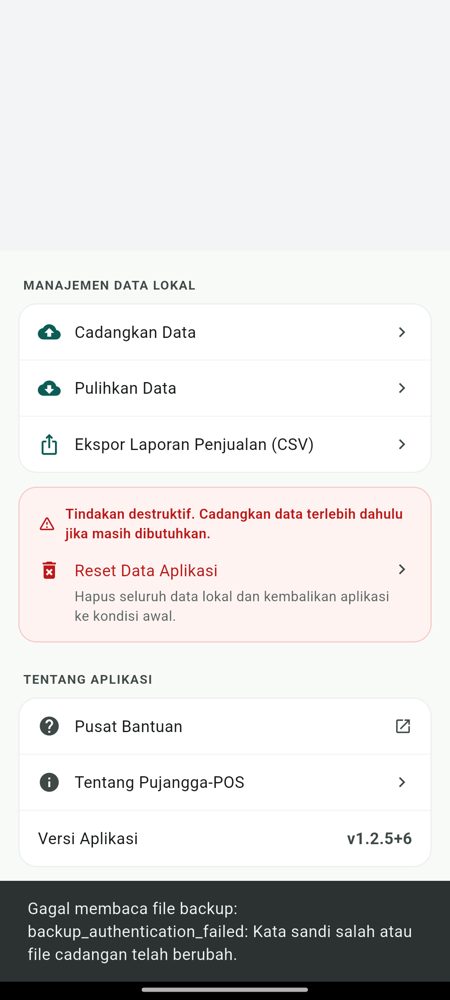
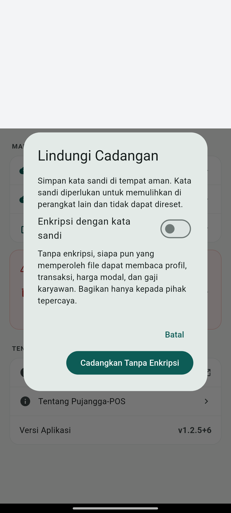
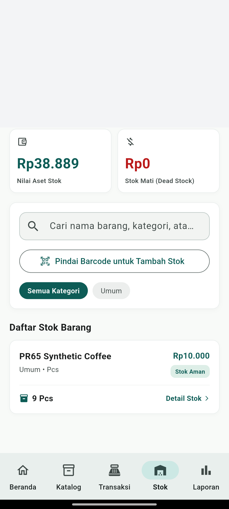

# PR #65 — E2E backup terenkripsi pada Android

**Hasil: lulus, `01:40 +1: All tests passed!`, exit code 0.**

Pengujian selesai 11 November 2026, 14:54–14:56 WIB. Revisi kode produk yang
diuji: `7abff2b005c4664c79134c9a7a04a2648c4aed66`, head PR #65 yang diverifikasi
sebelum dan sesudah tes. Penambahan harness/laporan tidak mengubah `lib/`.
Tidak dilakukan merge atau deployment produksi.

## Target dan isolasi

- Xiaomi 2201116TG fisik, Android 13; Flutter 3.47.9 / Dart 3.13.7.
- Paket APK diperiksa sebelum instalasi: `com.pujanggapos.pujangga_pos.pr65e2e`,
  versi `1.2.5-debug`, versionCode 6. Suffix khusus hanya aktif bila
  `PUJANGGA_ENCRYPTION_E2E=1`; debug biasa tetap `.debug`.
- `flutter test --no-uninstall` dipakai. Tidak ada clear-data atau uninstall.
- Dua path database eksplisit di direktori cache baru milik paket uji. Package
  identity dan containment path diperiksa sebelum SQLite dibuka. Fixture profil,
  barang, modal, stok, dan karyawan bergaji seluruhnya sintetis. Database aplikasi
  utama tidak dibuka, disalin, atau dibandingkan oleh tes.
- Inventaris paket awal/akhir identik pada run yang lulus. Metadata aplikasi utama
  tetap versi 1.2.4, versionCode 5, lastUpdateTime 10 November 2026 09:30:39.
  Ini membuktikan pemasangan aplikasi utama tidak berubah, bukan rekonsiliasi isi
  database aplikasi utama. Pemisahan package/path menjadi batas isolasi data.
- Teardown menghapus kedua database dan direktori fixture. Pemeriksaan ADB terpisah
  setelah run tidak menemukan direktori cache `encryption-e2e-*`. Runner menghapus
  tepat satu file Downloads miliknya dan memverifikasi file itu tidak ada lagi.
  Paket uji dan cache plugin file-picker/share tetap terpasang; isinya hanya file
  sintetis milik pengujian.

## Hasil per skenario

| Skenario | Bukti hasil |
| --- | --- |
| Checkout melalui UI | Barang Rp10.000 dibayar dengan label QRIS, layar berhasil muncul; satu transaksi tersimpan dan stok 10 → 9. QRIS tidak terhubung penyedia pembayaran. |
| Ekspor terenkripsi dari Pengaturan | Enkripsi default aktif, kata sandi kosong ditolak. Kata sandi dan konfirmasi dimasukkan melalui UI. File nyata berhasil dibuat, tanpa nama usaha, nama karyawan, gaji, modal, kata sandi, atau struktur `tables` sebagai plaintext. |
| Native Sharesheet | Runner mengamati ChooserActivity untuk ekspor terenkripsi dan polos, mengambil bukti lokal lalu mengirim Back. Tidak memilih penerima atau mengirim file ke pihak lain. |
| Interoperabilitas Android → Python | Envelope Android diautentikasi dan didekripsi dengan Python `cryptography` 47.0.0. Gaji sintetis dan satu transaksi diperiksa dari payload yang didekripsi. |
| Pembatalan kata sandi, kata sandi salah, ciphertext dimodifikasi | Pembatalan kembali ke Pengaturan. Kata sandi salah dan modifikasi satu byte ciphertext ditolak tanpa preview restore. Snapshot seluruh tabel database aktif tetap identik. |
| Interoperabilitas Python → Android | Python menghasilkan salt/nonce baru dan mengenkripsi ulang payload menggunakan implementasi AES-GCM/PBKDF2 independen. File dipindah ke Downloads dengan nama unik milik run. Pemilih dokumen Android asli menyeleksi file itu; dialog kata sandi dan konfirmasi restore aplikasi asli dipakai. |
| Restore ke database tujuan baru | Profil sentinel tujuan diganti. Seluruh tabel hasil restore dibandingkan dengan snapshot sumber, termasuk profil, pengaturan, katalog, transaksi, histori stok, dan karyawan. Semuanya identik. |
| Pembatalan preview restore | Setelah kata sandi benar dan preview tampil, Batal tidak mengubah tabel mana pun. |
| Ekspor polos dan impor JSON lama | Enkripsi dimatikan secara eksplisit melalui switch, peringatan gaji/data sensitif tampil, dan Sharesheet terbuka. JSON polos yang dihasilkan diimpor tanpa permintaan kata sandi, mengembalikan profil sentinel yang sudah diubah dan seluruh tabel sumber. |
| Buka ulang aplikasi/database | Seluruh widget/provider dilepas, koneksi SQLite ditutup, database dibuka dengan objek baru dan aplikasi dipasang kembali. Seluruh tabel tetap identik; halaman Stok menampilkan barang sintetis dengan stok 9. |
| Integritas dan log | `PRAGMA integrity_check = ok`, `foreign_key_check` kosong. Kata sandi sintetis tidak ditemukan pada pesan log aplikasi yang dikumpulkan. |

Hanya batas dependensi untuk lokasi database/direktori file yang diarahkan ke
fixture. UI, router, repository, controller backup/restore, enkripsi, SQLite,
SharePlus, serta pemilih dokumen pada impor independen memakai implementasi asli.
Skenario negatif dan impor JSON polos memakai pemilih file deterministik agar
memilih tepat file fixture yang dimaksud; parsing dan restore tetap asli.
Fixture awal diisi melalui SQLite, bukan onboarding/katalog UI.

## Eksekusi dan bukti

```powershell
rtk proxy C:\tmp\puro\envs\security-patch\flutter\bin\flutter.bat pub get --enforce-lockfile
rtk proxy python tools/run_encryption_e2e.py --device <adb-serial> --flutter C:\tmp\puro\envs\security-patch\flutter\bin\flutter.bat --output build/encryption-e2e-final
rtk proxy C:\tmp\puro\envs\security-patch\flutter\bin\flutter.bat analyze --no-pub
```

Runner memerlukan Python dengan paket `cryptography`. Hasil tersimpan pada
`build/encryption-e2e-final/` yang diabaikan Git: log build/run, manifest APK,
inventaris awal/akhir, bukti transport kriptografi, screenshot lokal, dan hasil.
[Ringkasan run](pr65-encryption-e2e/result.txt) disertakan untuk reviewer.

SHA-256 APK yang benar-benar diuji setelah rebuild oleh Flutter test:
`e09e9d7e8d62d21d6ecad7d14b93ede09b3191290111e67e7d720b1e5196b961`.

Percobaan awal gagal pada harness: API keyboard khusus widget test tidak tersedia
pada binding perangkat. Percobaan berikutnya tertahan pada `pumpAndSettle` karena
spinner di belakang dialog kata sandi terus berjalan; dialog dibatalkan melalui
ADB untuk mengakhiri run dan menjalankan teardown. Harness diperbaiki memakai
unfocus dan tunggu kondisi dialog. Percobaan ketiga berhenti ketika DocumentsUI
belum menyediakan accessibility root; runner kini mencoba ulang kondisi tersebut.
Proses uji dan direktori fixture run terputus dihentikan/dibersihkan secara terbatas.
Tidak ada perbaikan kode produk akibat percobaan tersebut.

Pada run terakhir, DocumentsUI dari run terputus masih di depan setelah instalasi
ulang, sedangkan PID aplikasi uji tidak ada. Paket uji diluncurkan melalui `adb am
start` saat runner Flutter masih hidup menunggu koneksi; tes kemudian dimulai
dan seluruh rangkaian lulus. Bukan memulai ulang tes yang sudah berjalan.
Log percobaan sebelumnya tetap lokal pada `build/encryption-e2e*`.

## Bukti visual yang disamarkan

25% area atas gambar ditutup untuk menghilangkan notifikasi/identitas perangkat.
Screenshot native chooser/picker mentah tetap lokal karena bisa menampilkan
identitas akun atau tujuan berbagi perangkat dan tidak disertakan ke Git.









## Batas cakupan

Ini satu perangkat Android fisik dengan dua database terpisah dan implementasi
kriptografi Python independen; bukan transfer antara dua HP fisik. Reopen mencakup
widget/provider dan koneksi SQLite, bukan cold-start proses OS. Tes tidak mencakup
penerima berbagi, onboarding, semua fitur POS, atau distribusi Play Store.
Hasil membuktikan skenario backup terenkripsi yang diuji pada revisi di atas.
